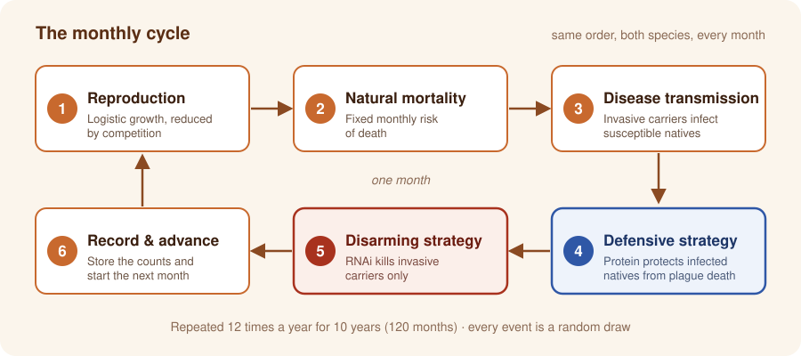

<p align="center">
  
</p>

<h1 align="center">Stochastic Treatment Efficacy Model</h1>

<p align="center">
  <b>Modelling RNAi and protein supplementation strategies against crayfish plague</b><br>
  Dry Lab model of project <b>ASTACI</b> · iGEM 2026 · University of Lausanne
</p>

<p align="center">
  <a href="https://github.com/catalantatayandres-glitch/stochastic-treatment-efficacy-model/actions/workflows/tests.yml"></a>
  
  
</p>

<p align="center">
  <a href="https://2026.igem.wiki/unilausanne/model/">Wiki model page</a> · <a href="#quickstart">Quickstart</a>
</p>

---

## What is iGEM?

**iGEM** (International Genetically Engineered Machine) is the world's largest synthetic
biology competition. It started at MIT in 2003 and is now run by the independent, non-profit
iGEM Foundation. Every year, student teams from around the world spend several months
designing, building and testing biological solutions to real-world problems. Each team
combines **wet-lab** experiments, **dry-lab** modelling and **human practices**, which means
working with stakeholders and society. Teams document everything on a public wiki and present
their project at the annual Grand Jamboree.

## Our project: ASTACI

> *"For more than a century, European crayfish populations have been declining at an alarming
> rate. Today, native crayfish survive only in isolated freshwater habitats."*

The main cause is **crayfish plague**, a disease caused by the oomycete *Aphanomyces astaci*.
It arrived in Europe with North American crayfish such as the **signal crayfish**
(*Pacifastacus leniusculus*), which carry the pathogen without getting sick. When they share a
river with native species such as the **white-clawed crayfish** (*Austropotamobius pallipes*),
the pathogen spills over, and infected natives die at rates approaching 100 %. In Switzerland,
all native crayfish species are now considered highly threatened, while *A. astaci* keeps
spreading through the country's waterways.

The **UNILausanne** team from the University of Lausanne designed **ASTACI**, a three-part
synthetic biology response:

|  |  |  |
|:---:|:---:|:---:|
| **Detect** the pathogen | **Disarm** the carrier | **Defend** the crayfish |
| LAMP test for *A. astaci* DNA in water samples | RNAi makes invasive carriers susceptible | Protein supplement makes natives tolerant |

**This repository holds the Dry Lab model behind *Disarm* and *Defend*.** It is a stochastic
population model that predicts what each intervention, or a combination of the two, would do
to a river's crayfish populations over ten years. The model guided the team's decision on how
to deploy the two treatments.

---

# The model

<p align="center">
  <a href="#introduction">Introduction</a> ·
  <a href="#how-the-model-works">How the model works</a> ·
  <a href="#parameters">Parameters</a> ·
  <a href="#results">Results</a> ·
  <a href="#discussion">Discussion</a> ·
  <a href="#validation">Validation</a> ·
  <a href="#other-explorations">Other explorations</a> ·
  <a href="#assumptions">Assumptions</a> ·
  <a href="#limitations">Limitations</a> ·
  <a href="#references">References</a>
</p>

## Introduction

Our project developed two strategies: an **RNAi-based tool that makes the invasive carrier
susceptible** to crayfish plague (*disarm*), and a **protein supplement that gives native
crayfish tolerance** to the disease (*defend*). We built the model to answer two questions:

1. Would these strategies make a measurable difference to the survival of native crayfish?
2. What is the best way to deploy them: together, alone, or in a specific combination?

## How the model works

The model follows both crayfish populations **month by month for 10 years** (120 steps). It
counts individual animals and splits each population by infection status:

- **Invasive:** $I = I_S + I_C$, where $I_S$ are non-carriers and $I_C$ are pathogen carriers
- **Native:** $N = N_S + N_I$, where $N_S$ are susceptible and $N_I$ are infected

Each month, six events happen in the same order for both species:

<p align="center">
  
</p>
<p align="center"><sub><b>Figure 1.</b> The monthly cycle of the model. The six events run in the same order for the invasive and native populations, 12 times a year over 10 years.</sub></p>

Every event is a **random draw**, so no two runs are identical. We therefore run 30–50
replicates for each condition and report the **median** trajectory, with a band from the 10th
to the 90th percentile.

<details>
<summary><b>Show the model equations</b></summary>
<br>

**1 · Reproduction.** Lotka–Volterra logistic recruitment, drawn from a Poisson distribution:

$$R_I \sim \text{Poisson}\Big(\max\big(0,\ r_I\, I\,\big(1 - \tfrac{I + \alpha_{IN} N}{K_I}\big)\big)\Big), \qquad
R_N \sim \text{Poisson}\Big(\max\big(0,\ r_N\, N\,\big(1 - \tfrac{N + \alpha_{NI} I}{K_N}\big)\big)\Big)$$

A fraction $p_{\text{rc}}$ of invasive recruits are carriers. All native recruits are susceptible.

**2 · Natural mortality.** Each animal dies with monthly probability $m_I$ or $m_N$, drawn as
$\text{Binomial}(n, m)$.

**3 · Disease transmission.** Frequency-dependent spillover from invasive carriers to
susceptible natives:

$$p_{\text{inf}} = 1 - \exp\Big(-\beta\,\frac{I_C}{I + \varepsilon}\Big), \qquad \text{new infections} \sim \text{Binomial}(N_S,\ p_{\text{inf}})$$

**Treatment split.** A coverage $c$, the share of animals that meet a dose each month, is
divided between the two payloads by the RNAi share $f$ (`mix_fraction_kill`):

$$p_{\text{kill}} = c\,f, \qquad p_{\text{protect}} = c\,(1-f)$$

Interference between the payloads is **asymmetric**, because the biology is. A carrier that
takes up both payloads in the same month is rescued, since the protein restores the tolerance
that RNAi silenced. Natives never expressed the target gene, so RNAi has no effect on them.

**4 · Defensive strategy.** Protected infected natives survive the month. Unprotected ones die
with probability $\mu_A$:

$$P \sim \text{Binomial}(N_I,\ p_{\text{protect}}\,e_N), \qquad \text{plague deaths} \sim \text{Binomial}(N_I - P,\ \mu_A)$$

**5 · Disarming strategy.** RNAi kills **carriers only**, so it removes the disease reservoir
without affecting non-carriers:

$$\text{RNAi deaths} \sim \text{Binomial}\big(I_C,\ p_{\text{kill}}\,(1-p_{\text{protect}})\,e_I\big)$$

**Optional migration.** When it is switched on, each sub-population loses
$\text{Binomial}(n, m_{\text{mig}})$ emigrants and gains $\text{Poisson}(m_{\text{mig}} K)$
immigrants from surrounding populations assumed to be at carrying capacity.

</details>

## Parameters

<details>
<summary><b>Click to see the 13 parameters</b>: definition, value used and literature basis</summary>
<br>

All rates are **monthly**. The values are those of the reference scenario used in the main
results.

| Parameter | Definition | Value used | Basis |
|---|---|:---:|---|
| $I_0,\ N_0$ | Starting population of each species | $0.2\,K$ | Modelling choice: set relative to each species' carrying capacity |
| $p_{C0}$ | Share of invasive crayfish carrying the pathogen at the start | 0.2 | Filipová et al. 2013: 20 % of more than 500 signal crayfish tested positive, averaged over 45 populations |
| $p_{\text{rc}}$ | Share of new invasive recruits that are carriers | 0.2 | Same source as $p_{C0}$ |
| $r_I,\ r_N$ | Intrinsic growth rate | 0.45, 0.12 | Calibrated from fecundity data; invasives grow about four times faster. Red swamp crayfish used as a proxy where signal crayfish data were missing (Jin et al. 2019; Wendler et al. 2015; Grandjean et al. 2000) |
| $K_I,\ K_N$ | Carrying capacity, the "habitat" | 6,400, 5,500 | Field densities (Bubb et al. 2011; Guan 2000; Wendler et al. 2015; Grandjean et al. 2000; Pearson 2011) |
| $\alpha_{IN},\ \alpha_{NI}$ | Competition coefficients | 0.3, 0.5 | No literature value; only the direction is documented (Vaeßen & Hollert 2015). Level calibrated in [Validation](#validation) |
| $m_I,\ m_N$ | Natural mortality | 0.08, 0.01 | Invasive from an annual estimate (Jin et al. 2019); native back-calculated from a 9–11 year lifespan (Wendler et al. 2015) |
| $\beta$ | Transmission coefficient | 0.9 | No literature value, an open problem (Bozzuto et al. 2024). Calibrated in [Validation](#validation) |
| $\mu_A$ | Plague mortality of infected natives | 0.8 | Near-total mortality within about 60–120 days (Martínez-Ríos et al. 2022; Martín-Torrijos et al. 2017) |
| $c$ | Coverage: share of crayfish reached by treatment each month | 0.5 | No literature value; scenario choice |
| $f$ | Strategy split: 0 = defend only, 1 = disarm only | 0 → 1 | The decision variable being studied |
| $e_I,\ e_N$ | Treatment efficacy | 1.0 | A best-case target, not a measured value |
| $m_{\text{mig}}$ | Monthly migration rate | 0 (off) | Qualitative movement data (Bubb et al. 2004, 2006) |

**Scenario presets used across the analyses**

| Habitat | $K_I$ | $K_N$ |
|---|:---:|:---:|
| Favors native | 5,000 | 6,400 |
| **Neutral** (reference) | **6,400** | **5,500** |
| Balanced | 8,000 | 3,000 |
| Favors invasive | 11,000 | 1,400 |

| Competition | $\alpha_{IN}$ | $\alpha_{NI}$ |
|---|:---:|:---:|
| Low | 0.1 | 0.3 |
| **Moderate** (reference) | **0.3** | **0.5** |
| High | 0.7 | 0.9 |

</details>

## Results

### From efficacy to field application

A sensitivity analysis showed which parameters matter most (see
[Other explorations](#other-explorations)). We fixed habitat, competition and transmission at
the values selected in [Validation](#validation), then swept the strategy split $f$ from 0
(protein only) to 1 (RNAi only) at 50 % coverage and 100 % efficacy.

<p align="center">
  
</p>
<p align="center"><sub><b>Figure 2.</b> Native crayfish population over 10 years under six treatment strategies in the same scenario (Neutral habitat, moderate competition, β = 0.9). Lines show the median of the simulation runs; shaded areas show the range of likely outcomes.</sub></p>

### A monotonic trend

**The more RNAi (disarm) is delivered relative to protein (defend), the better the outcome for
the native population.**

| Strategy | Natives after 10 years (start ≈ 1,100) |
|---|---|
| No treatment | Extinct within about 4 years |
| Protein supplementation (`mix = 0`) | Extinct within about 5 years, close to no treatment |
| Mixed (`mix = 0.25`) | Extinct within about 8 years |
| Mixed (`mix = 0.5`) | About 115 and still declining |
| Mixed (`mix = 0.75`) | About 620 and stable |
| **RNAi strategy (`mix = 1`)** | **About 1,240 and growing** |

### Testing the trend more broadly

We tested efficacy from 20 % to 100 %, coverage from 10 % to 90 %, different starting
conditions, disease severity, competition strength, and invasive migration. **The same pattern
held in every case.** The details are in [Other explorations](#other-explorations).

### Reconsidering the role of protein supplementation

La Maison de la Rivière, a Swiss foundation, reported that native crayfish reintroduced into a
lake with **no invasive crayfish** still died, because *A. astaci* was already in the water.
RNAi cannot help in that situation, because there is no carrier to target. Protein
supplementation is the right tool for reintroductions into habitats like this, which are free
of invaders but still carry the pathogen.

<p align="center">
  
</p>
<p align="center"><sub><b>Figure 3.</b> Protein supplementation in an invasive-free, pathogen-positive habitat. Left: without treatment, introduced native crayfish die. Right: with protein supplementation, they survive. Created with BioRender.com.</sub></p>

## Discussion

Native crayfish face **two problems** at once:

1. **Competition.** Invasive crayfish outcompete natives even without the pathogen, though less severely than when it is present (Pritchard 2020).
2. **Disease.** Invasive carriers transmit crayfish plague, which kills almost every infected native.

The defensive strategy only addresses the disease. The disarming strategy addresses both: it
removes the source of transmission and also shrinks the invasive population. **This explains
the monotonic trend.**

The model cannot represent a habitat that holds the pathogen but no invader, because that would
require tracking the pathogen on its own. This is why the team kept developing the defensive
strategy for reintroduction programmes.

## Validation

Untreated, the model reproduces a real, documented collapse of native crayfish
(Bubb, Thom & Lucas 2006) with a **95 % match**, using moderate competition and β = 0.9.

<details>
<summary><b>Click to see the 5 validation steps</b></summary>
<br>

**Step 1 · Trusting the model before trusting its results.** A model can be internally
consistent and still wrong, so we tested it against a real outcome.

**Step 2 · Defining a tractable validation strategy.** Competition and transmission were the
most influential parameters with no independent literature value. We checked whether an
untreated run reproduces the shape and severity of a documented decline.

**Step 3 · A documented case of native displacement.** Bubb, Thom & Lucas (2006) tracked 15
invasive signal crayfish and 20 native white-clawed crayfish at one river site in 2003. By 2005
**no native crayfish remained**, while the invasive density had increased.

**Step 4 · Fitting the model to a known outcome.** In the Neutral habitat, with no treatment,
we ran a grid of three competition levels and β from 0.5 to 0.9 over the same two years, and
compared the results with the real decline.

**Step 5 · Selecting moderate competition and β = 0.9.** The closest fit was high competition
(97 %), but we rejected it: a Neutral habitat paired with high competition would be internally
inconsistent. **Moderate competition with β = 0.9 matches at 95 %.** In that scenario, natives
fall by 95 % over two years while invasives grow by more than 300 %. The remaining gap probably
reflects harsher conditions at the real site than our Neutral scenario assumes.

</details>

<table>
  <tr>
    <td width="50%"></td>
    <td width="50%"></td>
  </tr>
  <tr>
    <td valign="top"><sub><b>Figure 4.</b> Fit between the model and the native decline documented by Bubb et al. (2006): median native decline after two years without treatment. 100 % would match the real outcome exactly. The outlined cell is the selected scenario.</sub></td>
    <td valign="top"><sub><b>Figure 5.</b> Native and invasive trajectories under the selected scenario (Neutral habitat, moderate competition, β = 0.9, no treatment) over the same two-year window. Lines are medians; bands span the 10th to 90th percentile.</sub></td>
  </tr>
</table>

## Other explorations

<details>
<summary><b>1 · Sensitivity analysis</b></summary>
<br>

Each of 17 ecological and disease parameters was varied over 3–5 values while all the others
stayed at baseline. Treatment was fixed at 80 % coverage, an 80 % RNAi share and 100 %
efficacy. The bars show how far the median final native population moves across each
parameter's tested range. **Transmission (β), native carrying capacity and the share of
carrier recruits matter most.** This is why β was calibrated against field data.

<p align="center"></p>
</details>

<details>
<summary><b>2 · Testing across ecological scenarios</b></summary>
<br>

We tested 3 habitats × 3 competition levels × 3 transmission levels. Each cell shows the
**RNAi advantage**: the median final native population under disarm minus the same under
defend. RNAi wins outright in **22 of 27** scenarios and never loses. In the other 5, both
strategies end at zero, which is a floor effect rather than a protein win.

<p align="center"></p>
</details>

<details>
<summary><b>3 · The influence of treatment performance</b></summary>
<br>

Coverage and efficacy were each swept from 20 % to 100 %. RNAi preserves natives across most
of the grid. Protein supplementation only holds them when **coverage × efficacy stays above
about 95 %**, because every infected native must be protected every month. At 90 % delivery
natives fall to about 200, and at 85 % they are nearly gone, while RNAi keeps more than 1,800
across the same range. This makes protein supplementation the least robust option in the
field.

<p align="center"></p>
</details>

<details>
<summary><b>4 · Migration effect</b></summary>
<br>

We switched on 5 % monthly migration in both directions for both species, with the surrounding
populations assumed to be at carrying capacity. The RNAi strategy still preserves the natives,
and immigrants from the untreated surroundings raise the plateau further. This result depends
on those surrounding populations being healthy.

<p align="center"></p>
</details>

## Assumptions

<details>
<summary><b>Show the 12 modelling assumptions</b></summary>
<br>

1. **Neutral habitat as the reference.** Main results use a habitat that favors neither species, so the strategies are tested under non-extreme conditions.
2. A single, well-mixed site with no spatial structure.
3. Monthly time steps, with events always applied in the same order.
4. Logistic recruitment with Lotka–Volterra competition, and no breeding season.
5. Only invasive carriers transmit the pathogen; infected natives are not a source of infection.
6. Carriers suffer no disease mortality and, by default, no fitness cost.
7. A fixed 20 % of invasive recruits are carriers, regardless of their parents' status.
8. Infected natives do not recover on their own.
9. Protection lasts one month and must be renewed every month.
10. RNAi affects carriers only, and the two payloads interfere asymmetrically.
11. Treatment is delivered every month.
12. Migration, when switched on, uses the same rate for both species. This is a deliberate simplification: signal crayfish disperse about twice as far (Bubb et al. 2006).
</details>

## Limitations

<details>
<summary><b>Show the 6 limitations</b></summary>
<br>

1. Competition and transmission have no literature values and were calibrated on a single documented site.
2. Validation is qualitative rather than a statistical fit.
3. The sensitivity analysis varies one parameter at a time, so it misses interactions. A global method such as Sobol would capture them.
4. Some demographic rates use red swamp crayfish (*Procambarus clarkii*) as a proxy.
5. The pathogen is not tracked on its own, so habitats with the pathogen but no invader cannot be simulated.
6. Coverage and efficacy are target values, not measured field performance.
</details>

## References

1. Bozzuto, C. et al. (2024). *Journal of Freshwater Ecology.*
2. Bubb, D.H., Thom, T.J. & Lucas, M.C. (2004). Movement and dispersal of the invasive signal crayfish *Pacifastacus leniusculus* in upland rivers. *Freshwater Biology*, 49, 357–368.
3. Bubb, D.H., Thom, T.J. & Lucas, M.C. (2006). Movement, dispersal and refuge use of co-occurring introduced and native crayfish. *Freshwater Biology*, 51, 1359–1368.
4. Bubb, D.H. et al. (2011).
5. Filipová, L. et al. (2013). *PLOS ONE.*
6. Grandjean, F. et al. (2000).
7. Guan, R.-Z. (2000).
8. Jin, S. et al. (2019). *PeerJ.*
9. Martín-Torrijos, L. et al. (2017).
10. Martínez-Ríos, M. et al. (2022).
11. Pearson, M. (2011).
12. Pritchard, E. (2020). *The Conversation.*
13. Vaeßen, S. & Hollert, H. (2015).
14. Wendler, F. et al. (2015). *Knowledge and Management of Aquatic Ecosystems.*
15. La Maison de la Rivière, personal communication (not a published source).

Full citations are on the [team wiki](https://2026.igem.wiki/unilausanne/model/).

---

# Using the code

## Quickstart

```bash
git clone https://github.com/catalantatayandres-glitch/stochastic-treatment-efficacy-model.git
cd stochastic-treatment-efficacy-model
pip install -e ".[dev]"        # or: pip install -r requirements.txt

python run_all.py              # regenerate every figure in figures/ (about 30 s)
python run_all.py main_results # or a single analysis
pytest                         # run the test suite
```

All runs are seeded, so the same code and library versions regenerate identical figures.

**Use the model as a library:**

```python
from stochastic_treatment_efficacy_model import DEFAULT_PARAMS, simulate_combined_treatment

params = {**DEFAULT_PARAMS, "K_I": 6400, "K_N": 5500, "beta": 0.9,
          "overall_encounter_rate": 0.5, "mix_fraction_kill": 1.0}   # 50 % coverage, RNAi only
df = simulate_combined_treatment(params, seed=0)   # one row per month
print(df[["year", "I", "N", "RNAi_deaths_I", "plague_deaths"]].tail())
```

| Script | Wiki section | Output |
|---|---|---|
| [`analyses/main_results.py`](analyses/main_results.py) | Results (Figure 2) | `wiki_figure_transmission_0.9.png` |
| [`analyses/validation_bubb2006.py`](analyses/validation_bubb2006.py) | Validation (Figures 4–5) | `validation_figure1_grid.png`, `validation_figure2_selected_scenario.png` |
| [`analyses/sensitivity_analysis.py`](analyses/sensitivity_analysis.py) | Other explorations 1 | `sensitivity_tornado_wiki.png` |
| [`analyses/scenario_robustness.py`](analyses/scenario_robustness.py) | Other explorations 2 | `other_explorations_habitat_competition_transmission.png` |
| [`analyses/coverage_efficacy.py`](analyses/coverage_efficacy.py) | Other explorations 3 | `other_explorations_coverage_efficacy_absolute.png` |
| [`analyses/migration_effect.py`](analyses/migration_effect.py) | Other explorations 4 | `other_explorations_migration_effect.png` |

## Repository structure

```
stochastic-treatment-efficacy-model/
├── src/stochastic_treatment_efficacy_model/
│   └── engine.py        # the stochastic model: parameters, validation, simulation
├── analyses/            # one script per wiki section; each saves a figure
├── figures/             # generated figures (300 DPI)
├── docs/images/         # logo, illustrations and the monthly-cycle diagram
├── tests/               # pytest suite: model invariants + end-to-end checks
├── run_all.py           # regenerate every figure
├── pyproject.toml
└── requirements.txt
```

---

<p align="center">
  <sub>Developed by the <b>iGEM 2026 UNILausanne</b> team, University of Lausanne, Switzerland.<br>
  Code: <a href="LICENSE">MIT License</a> · Logo, illustrations and wiki content: © UNILausanne iGEM 2026, CC BY 4.0 · Figure 3 created with BioRender.com</sub>
</p>
