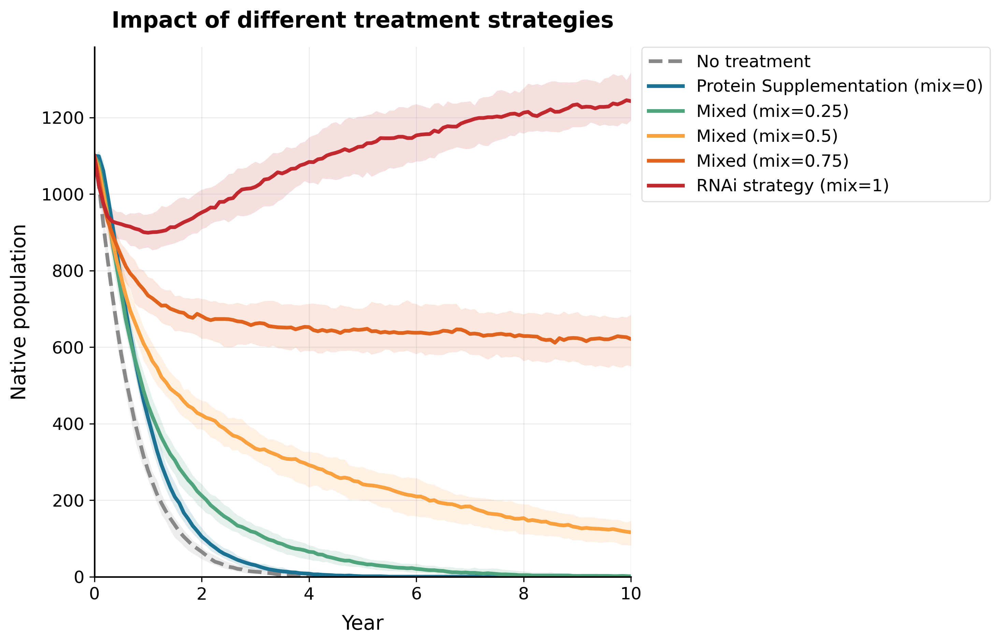
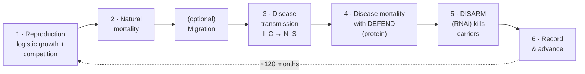
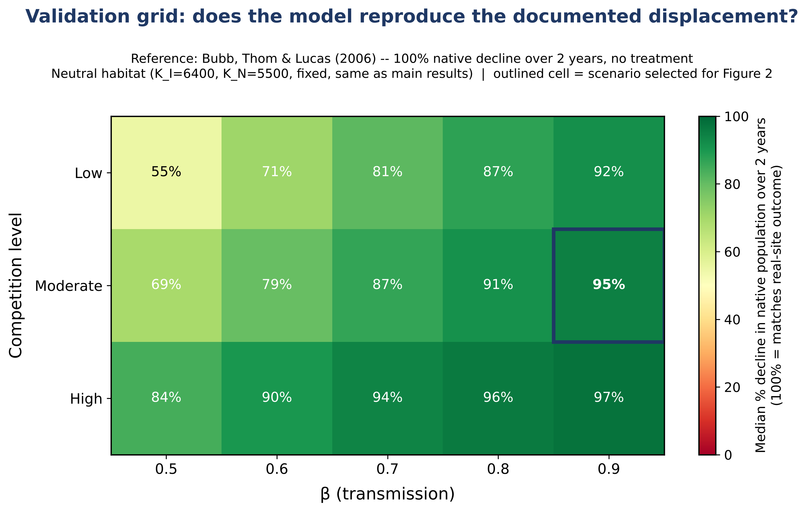
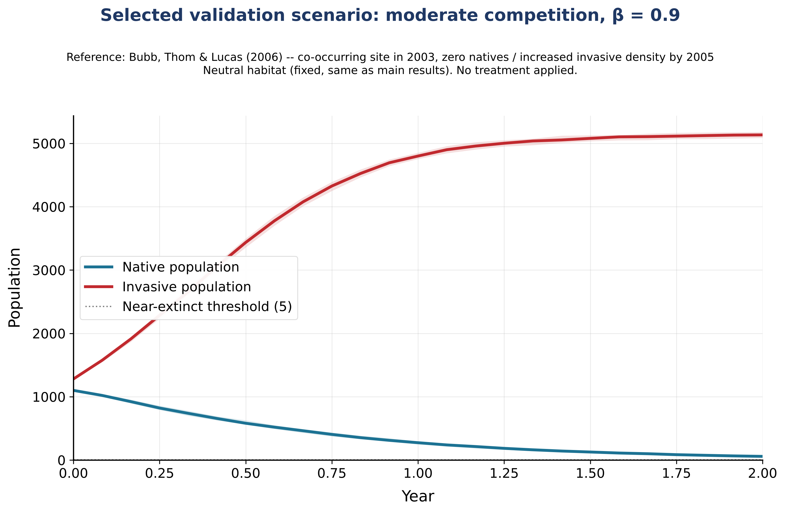
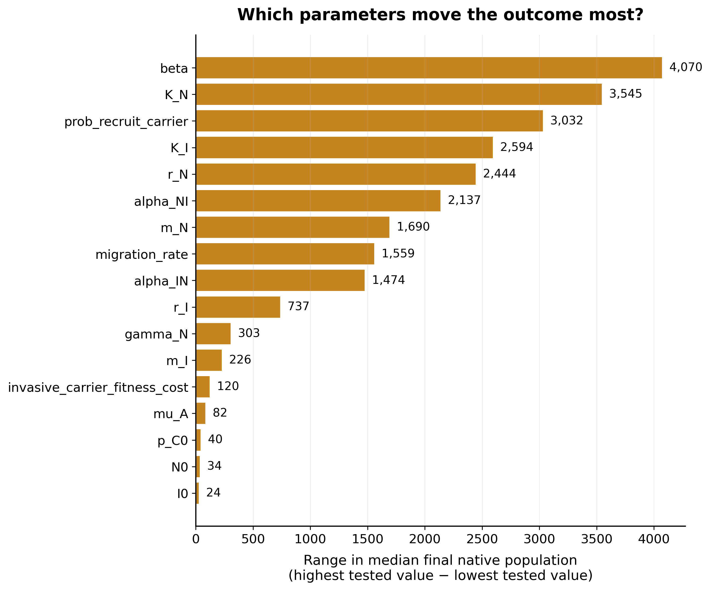
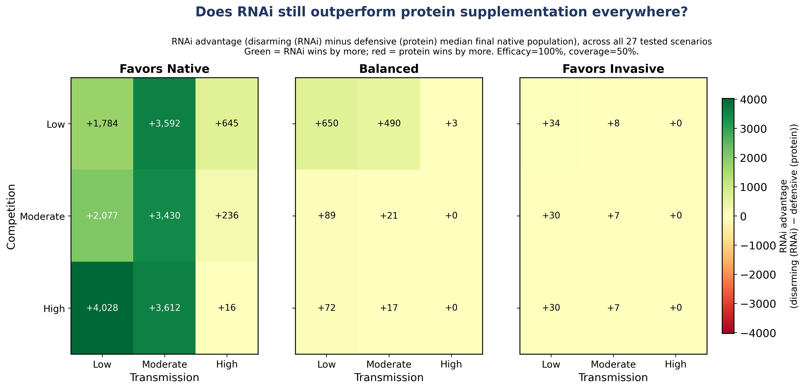
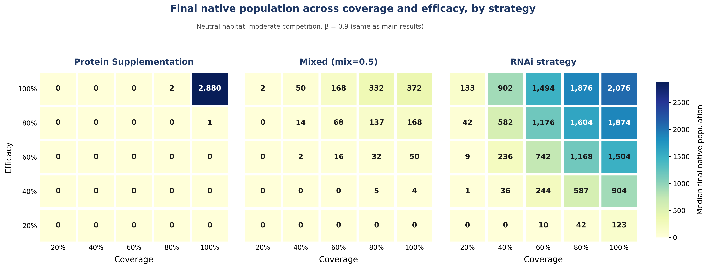
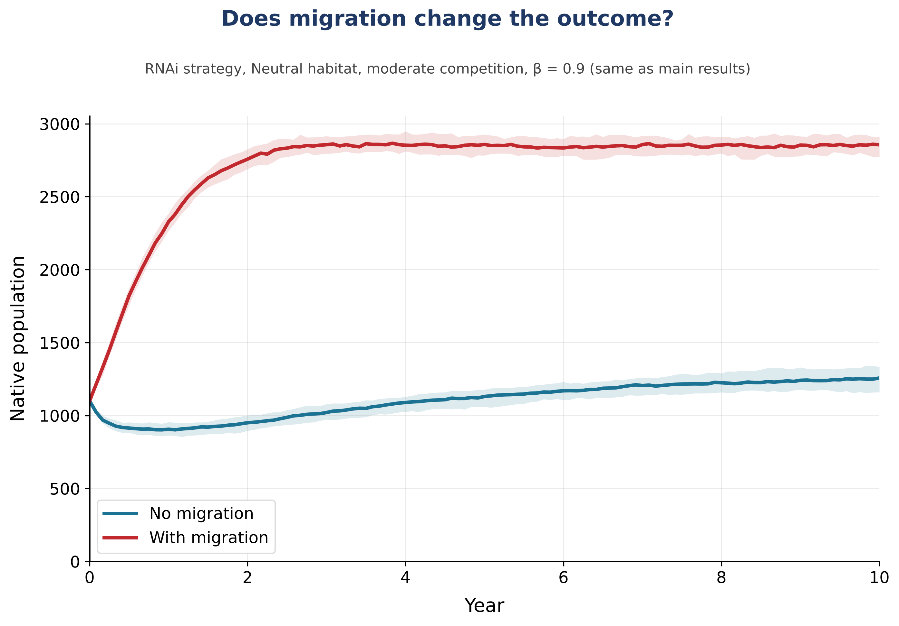

# Stochastic Treatment Efficacy Model

**Modelling RNAi and protein supplementation strategies against crayfish plague** · iGEM 2026 UNILausanne · *Disarm & Defend*

[](https://github.com/catalantatayandres-glitch/stochastic-treatment-efficacy-model/actions/workflows/tests.yml)


A stochastic population model that compares two biotechnological interventions against
*Aphanomyces astaci* (crayfish plague). The model tracks an invasive carrier species and a
susceptible native species month by month and asks one practical question: **given a fixed
treatment effort, how should it be split between the two interventions?**

| Strategy | Mechanism | Target |
|---|---|---|
| **Disarm** (RNAi) | dsRNA silences the invasive crayfish's own tolerance gene, so pathogen carriers die | Invasive carriers (the disease reservoir) |
| **Defend** (protein supplementation) | An exogenous protein gives infected natives tolerance to the disease | Infected native crayfish |

<p align="center">
  
</p>

### Key findings

- **There is a monotonic trend.** The larger the RNAi share of the treatment, the better the native population does. Pure RNAi (`mix = 1`) grows the native population over 10 years. Pure protein supplementation performs close to no treatment.
- **The trend is robust.** RNAi matches or beats protein supplementation in all 27 habitat × competition × transmission scenarios tested, and across 20–100 % efficacy and 20–100 % coverage.
- **The model is validated against field data.** With no treatment, it reproduces a documented native displacement (Bubb, Thom & Lucas 2006) to within 95 %.
- **Protein supplementation still has a niche.** It is the right tool where natives are reintroduced into habitats that hold the pathogen but no invasive crayfish, because RNAi has nothing to target there.

---

## Contents

1. [Introduction](#1-introduction)
2. [How the model works](#2-how-the-model-works)
3. [Parameters](#3-parameters)
4. [Results](#4-results)
5. [Discussion](#5-discussion)
6. [Validation](#6-validation)
7. [Other explorations](#7-other-explorations)
8. [Assumptions and limitations](#8-assumptions-and-limitations)
9. [Quickstart and reproducing the figures](#9-quickstart-and-reproducing-the-figures)
10. [Repository structure](#10-repository-structure)
11. [References](#11-references)

---

## 1. Introduction

The invasive signal crayfish carries *A. astaci* without being harmed by it. When it meets
native white-clawed crayfish, the pathogen spills over and wipes them out. Our team developed
two tools against this:

- **Disarm:** an RNAi construct that makes the invasive carrier susceptible to its own pathogen.
- **Defend:** a protein supplement that gives native crayfish tolerance to the disease.

The model was built to answer two questions:

1. Would these strategies make a measurable difference to native survival?
2. What is the best way to deploy them: together, alone, or in a specific combination?

## 2. How the model works

The model is a **discrete-time stochastic simulation with integer individuals**. It runs in
monthly steps over 10 years (120 steps). Each population is split by infection status:

- **Invasive:** $I = I_S + I_C$, where $I_S$ are non-carriers and $I_C$ are *A. astaci* carriers.
- **Native:** $N = N_S + N_I$, where $N_S$ are susceptible and $N_I$ are infected.

Every month the same sequence of events is applied to both species:



Each event is a random draw, so every run is different. For each condition the model runs
30–50 replicates and reports the **median** trajectory with a **10th–90th percentile band**.

<details>
<summary><b>Model equations</b> (click to expand)</summary>

**1. Reproduction.** Lotka–Volterra logistic recruitment, drawn from a Poisson distribution:

$$R_I \sim \text{Poisson}\Big(\max\big(0,\ r_I\, I\,\big(1 - \tfrac{I + \alpha_{IN} N}{K_I}\big)\big)\Big), \qquad
R_N \sim \text{Poisson}\Big(\max\big(0,\ r_N\, N\,\big(1 - \tfrac{N + \alpha_{NI} I}{K_N}\big)\big)\Big)$$

A fraction $p_{\text{rc}}$ of invasive recruits are carriers. All native recruits are susceptible.

**2. Natural mortality.** Each individual dies with monthly probability $m_I$ or $m_N$:
$D \sim \text{Binomial}(n, m)$.

**3. Transmission.** Frequency-dependent spillover from invasive carriers to susceptible natives:

$$p_{\text{inf}} = 1 - \exp\!\Big(-\beta\,\frac{I_C}{I + \varepsilon}\Big), \qquad \text{new infections} \sim \text{Binomial}(N_S,\ p_{\text{inf}})$$

**Treatment.** A coverage $c$ (fraction of animals that meet any dose per month) is split by
`mix_fraction_kill` $f$ between the two payloads:

$$p_{\text{kill}} = c\,f, \qquad p_{\text{protect}} = c\,(1-f)$$

Interference between the payloads is **asymmetric**, which reflects the biology:

- **Invasive carriers.** A carrier that also takes up the protein is rescued, because the protein restores the tolerance that RNAi silenced. The effective kill probability is therefore $p_{\text{kill}}\,(1 - p_{\text{protect}})\,e_I$.
- **Natives.** Natives never expressed the target gene, so RNAi has no effect on them. The effective protection probability is $p_{\text{protect}}\,e_N$.

**4. Disease mortality with Defend.** Protected infected natives survive the month. The
unprotected ones die with probability $\mu_A$:

$$P \sim \text{Binomial}(N_I,\ p_{\text{protect}}\,e_N), \qquad \text{plague deaths} \sim \text{Binomial}(N_I - P,\ \mu_A)$$

**5. Disarm.** RNAi kills **carriers only**. Non-carriers ($I_S$) are unaffected, so this is a
reservoir-elimination strategy rather than general population control:

$$\text{RNAi deaths} \sim \text{Binomial}\big(I_C,\ p_{\text{kill}}\,(1-p_{\text{protect}})\,e_I\big)$$

**Optional migration.** When `migration_rate` $> 0$, each sub-population loses
$\text{Binomial}(n, m_{\text{mig}})$ emigrants. Immigrants arrive as
$\text{Poisson}(m_{\text{mig}} K)$ from a surrounding population assumed to sit at its own
carrying capacity.

</details>

## 3. Parameters

Rates are **monthly**. Values are those of the reference scenario used in the main results.

| Symbol | Code name | Meaning | Value | Basis |
|---|---|---|---|---|
| $I_0,\ N_0$ | `I0`, `N0` | Initial population sizes | $0.2\,K_I$, $0.2\,K_N$ | Modelling choice |
| $p_{C0}$ | `p_C0` | Initial carrier prevalence | 0.2 | Filipová et al. 2013 (20 % of >500 signal crayfish positive) |
| $p_{\text{rc}}$ | `prob_recruit_carrier` | Fraction of recruits that are carriers | 0.2 | Same as $p_{C0}$ |
| $r_I,\ r_N$ | `r_I`, `r_N` | Intrinsic growth rate | 0.45, 0.12 | Fecundity data. Invasive grows about 4× faster (Jin et al. 2019; Wendler et al. 2015; Grandjean et al. 2000) |
| $K_I,\ K_N$ | `K_I`, `K_N` | Carrying capacity (habitat) | 6400, 5500 (Neutral) | Field densities (Bubb et al. 2011; Guan 2000; Wendler et al. 2015; Pearson 2011) |
| $\alpha_{IN},\ \alpha_{NI}$ | `alpha_IN`, `alpha_NI` | Competition coefficients | 0.3, 0.5 (moderate) | Direction only from literature (Vaeßen & Hollert 2015). Calibrated in [Validation](#6-validation) |
| $m_I,\ m_N$ | `m_I`, `m_N` | Natural mortality | 0.08, 0.01 | Jin et al. 2019. Native value back-calculated from a 9–11 year lifespan (Wendler et al. 2015) |
| $\beta$ | `beta` | Transmission coefficient | 0.9 | No literature value (Bozzuto et al. 2024). Calibrated in [Validation](#6-validation) |
| $\mu_A$ | `mu_A` | Disease mortality of infected natives | 0.8 | Near-total mortality within 60–120 days (Martínez-Ríos et al. 2022; Martín-Torrijos et al. 2017) |
| $c$ | `overall_encounter_rate` | Treatment coverage | 0.5 | Scenario value |
| $f$ | `mix_fraction_kill` | Strategy split: 0 = Defend only, 1 = Disarm only | 0 → 1 | Decision variable |
| $e_I,\ e_N$ | `efficacy_I`, `efficacy_N_protect` | Treatment potency | 1.0 | Best-case target |
| $m_{\text{mig}}$ | `migration_rate` | Monthly migration rate | 0 (off) | Qualitative movement data (Bubb et al. 2004, 2006) |

The **habitat scenarios** used across the analyses are: Favors Native
($K_I$ = 5000, $K_N$ = 6400), Neutral (6400, 5500), Balanced (8000, 3000) and Favors Invasive
(11000, 1400). The **competition levels** are low (0.1 / 0.3), moderate (0.3 / 0.5) and
high (0.7 / 0.9).

## 4. Results

### From efficacy to field application

With habitat, competition and transmission fixed at their validated values, the strategy split
$f$ was swept from 0 (Defend only) to 1 (Disarm only) at 50 % coverage and 100 % efficacy. The
results are shown in the figure at the top of this page.

### A monotonic trend

**The more RNAi relative to protein, the better the outcome for the native population.**

| Strategy | Native population after 10 years (start ≈ 1,100) |
|---|---|
| No treatment | Extinct within ~4 years |
| Protein supplementation (`mix = 0`) | Extinct within ~5 years |
| Mixed (`mix = 0.25`) | Extinct within ~8 years |
| Mixed (`mix = 0.5`) | ≈ 115, still declining |
| Mixed (`mix = 0.75`) | ≈ 620, stable |
| **RNAi (`mix = 1`)** | **≈ 1,240, growing** |

### Testing the trend more broadly

The same ordering holds across habitats, competition levels, transmission rates, coverage,
efficacy and migration. See [Other explorations](#7-other-explorations).

### Reconsidering the role of protein supplementation

The Swiss foundation La Maison de la Rivière reported that native crayfish reintroduced into a
lake with **no invasive crayfish** still died, because *A. astaci* was already present in the
lake. RNAi cannot help there, since there is no carrier to target. In that setting, invader-free
but pathogen-positive, protein supplementation is the appropriate tool.

## 5. Discussion

Invasive crayfish outcompete natives even without the pathogen, though less severely than when
the pathogen is present (Pritchard 2020). Natives therefore face two pressures: **competition**
and **disease**. Defend addresses only disease. Disarm addresses both, because it removes the
source of transmission and also shrinks the invasive population. This explains the monotonic
trend.

The model cannot represent a pathogen-only scenario, because that would require tracking the
pathogen independently of the invader. This is why the Defend strategy was kept in development
for reintroduction programmes.

## 6. Validation

**Trusting the model before trusting its results.** Competition ($\alpha$) and transmission
($\beta$) are the most influential parameters without an independent literature value. Instead
of fitting them blindly, we checked whether an untreated run reproduces a **documented field
displacement**.

**Reference case.** Bubb, Thom & Lucas (2006) tracked co-occurring signal and white-clawed
crayfish at one river site in 2003. By 2005 there were **zero native crayfish left**, while the
invasive density had increased.

**Fitting.** A grid of competition levels × $\beta \in [0.5, 0.9]$ was run in the Neutral habitat
with no treatment, over the same 2-year window:

<p align="center">
  
</p>

**Selection.** The closest fit was high competition (97 %), but it was rejected because a
Neutral habitat paired with high competition would be internally inconsistent. **Moderate
competition with β = 0.9 (95 % decline)** was selected. Under that scenario natives fall by 95 %
in two years while invasives grow by more than 300 %. The remaining gap likely reflects harsher
conditions at the real site than the Neutral scenario assumes.

<p align="center">
  
</p>

## 7. Other explorations

<details open>
<summary><b>Sensitivity analysis (one-at-a-time)</b></summary>

Each of 17 ecological and disease parameters was varied across 3–5 values while all other
parameters were held at baseline. Treatment was fixed at 80 % coverage, `mix = 0.8` and 100 %
efficacy. Bars show how far the median final native population moves across each parameter's
tested range. **Transmission (β), native carrying capacity and the carrier fraction of recruits
dominate.** This is why β was calibrated against field data in the validation step.

<p align="center">
  
</p>
</details>

<details open>
<summary><b>Testing across ecological scenarios (27 combinations)</b></summary>

The analysis covers 3 habitats × 3 competition levels × 3 transmission levels. Each cell shows
the RNAi advantage, defined as the median final native population under Disarm minus the same
under Defend. RNAi strictly outperforms protein in **22/27** scenarios and never underperforms it. In the
remaining 5 (+0), both strategies collapse to zero; this is a floor effect, not a protein win.

<p align="center">
  
</p>
</details>

<details open>
<summary><b>The influence of treatment performance (coverage × efficacy)</b></summary>

This plot shows the median final native population for each strategy across 20–100 % coverage
and 20–100 % efficacy. RNAi preserves natives over most of the grid. Protein supplementation
only holds them when **coverage × efficacy stays above about 95 %**, because every infected
native must be protected every month. At 90 % delivery natives fall to about 200, and at 85 %
they are nearly gone, while RNAi keeps more than 1,800 across the same range. This makes
protein supplementation the least robust option for field deployment.

<p align="center">
  
</p>
</details>

<details open>
<summary><b>Migration effect</b></summary>

Under the RNAi strategy, 5 %/month migration was switched on in both directions for both
species. The surrounding source populations are assumed to sit at their own carrying capacity.
The RNAi strategy still preserves the native population, and immigration of natives from the
untreated surroundings raises the plateau further. This result depends on the assumption that
the source populations are healthy.

<p align="center">
  
</p>
</details>

## 8. Assumptions and limitations

<details>
<summary><b>Key modelling assumptions</b></summary>

1. A single, well-mixed site with no spatial structure.
2. Discrete monthly time steps, with events always applied in the same order.
3. Logistic recruitment with Lotka–Volterra competition. Reproduction has no seasonality.
4. Transmission comes only from invasive carriers to native susceptibles. Infected natives are not modelled as a transmission source.
5. Carriers are asymptomatic: invasives suffer no disease mortality, and no carrier fitness cost is applied by default.
6. A fixed fraction of invasive recruits are carriers. Carrier status is not inherited from parents.
7. Infected natives do not recover (`gamma_N = 0`).
8. Protection lasts one month. Protected natives remain infected and must be protected again the next month.
9. RNAi affects carriers only, and the two payloads interfere asymmetrically (see the equations).
10. Treatment is delivered continuously, every month.
11. Migration, when enabled, uses the same rate for both species and both directions. This is a deliberate simplification: Bubb et al. (2006) found that signal crayfish disperse about twice as far.
</details>

<details>
<summary><b>Limitations</b></summary>

- $\alpha$ and $\beta$ have no literature values. They were calibrated qualitatively against one documented site.
- Validation uses a single field case and is qualitative, not a statistical fit.
- The sensitivity analysis is one-at-a-time, so it does not capture interactions between parameters. A global method such as Sobol would.
- Some demographic parameters use red swamp crayfish (*P. clarkii*) as a proxy where signal crayfish data were missing.
- The pathogen is not tracked independently of the invader, so pathogen-only habitats cannot be simulated.
- Efficacy and coverage are target values, not measured field performance.
</details>

## 9. Quickstart and reproducing the figures

```bash
git clone https://github.com/catalantatayandres-glitch/stochastic-treatment-efficacy-model.git
cd stochastic-treatment-efficacy-model
pip install -e ".[dev]"      # or: pip install -r requirements.txt

python run_all.py              # regenerate every figure in figures/
python run_all.py main_results # or just one analysis
pytest                         # run the test suite (about 5 s)
```

All runs are seeded: the same code and library versions regenerate identical figures.

**Using the model as a library:**

```python
from stochastic_treatment_efficacy_model import DEFAULT_PARAMS, simulate_combined_treatment

params = {**DEFAULT_PARAMS, "K_I": 6400, "K_N": 5500, "beta": 0.9,
          "overall_encounter_rate": 0.5, "mix_fraction_kill": 1.0}   # 50 % coverage, pure RNAi
df = simulate_combined_treatment(params, seed=0)   # one row per month
print(df[["year", "I", "N", "RNAi_deaths_I", "plague_deaths"]].tail())
```

| Analysis | Wiki section | Output figure |
|---|---|---|
| [`analyses/main_results.py`](analyses/main_results.py) | Results | `wiki_figure_transmission_0.9.png` |
| [`analyses/validation_bubb2006.py`](analyses/validation_bubb2006.py) | Validation | `validation_figure1_grid.png`, `validation_figure2_selected_scenario.png` |
| [`analyses/sensitivity_analysis.py`](analyses/sensitivity_analysis.py) | Other explorations: sensitivity | `sensitivity_tornado_wiki.png` |
| [`analyses/scenario_robustness.py`](analyses/scenario_robustness.py) | Other explorations: 27 scenarios | `other_explorations_habitat_competition_transmission.png` |
| [`analyses/coverage_efficacy.py`](analyses/coverage_efficacy.py) | Other explorations: coverage × efficacy | `other_explorations_coverage_efficacy_absolute.png` |
| [`analyses/migration_effect.py`](analyses/migration_effect.py) | Other explorations: migration | `other_explorations_migration_effect.png` |

## 10. Repository structure

```
stochastic-treatment-efficacy-model/
├── src/stochastic_treatment_efficacy_model/
│   └── engine.py          # the stochastic model: parameters, validation, simulation
├── analyses/              # one script per wiki section, each saves a figure
├── figures/               # generated figures (300 DPI)
├── tests/                 # pytest suite: engine invariants + end-to-end smoke tests
├── run_all.py             # regenerate every figure
├── pyproject.toml
└── requirements.txt
```

## 11. References

1. Bozzuto, C. et al. (2024). *Journal of Freshwater Ecology.*
2. Bubb, D.H., Thom, T.J. & Lucas, M.C. (2004). Movement and dispersal of the invasive signal crayfish *Pacifastacus leniusculus* in upland rivers. *Freshwater Biology*, 49, 357–368.
3. Bubb, D.H., Thom, T.J. & Lucas, M.C. (2006). Movement, dispersal and refuge use of co-occurring introduced and native crayfish. *Freshwater Biology*, 51, 1359–1368.
4. Bubb, D.H. et al. (2011).
5. Filipová, L. et al. (2013). *PLOS ONE.*
6. Grandjean, F. et al. (2000).
7. Guan, R.-Z. (2000).
8. Jin, S. et al. (2019). *PeerJ.*
9. Martín-Torrijos, L. et al. (2017).
10. Martínez-Ríos, M. et al. (2022).
11. Pearson, M. (2011).
12. Pritchard, E. (2020). *The Conversation.*
13. Vaeßen, S. & Hollert, H. (2015).
14. Wendler, F. et al. (2015). *Knowledge and Management of Aquatic Ecosystems.*
15. La Maison de la Rivière, personal communication.

Full references are on the [team wiki](https://2026.igem.wiki/unilausanne/model).

---

<sub>Developed by the <b>iGEM 2026 UNILausanne</b> team (Dry Lab). Code released under the
<a href="LICENSE">MIT License</a>. Wiki content © UNILausanne iGEM 2026, CC BY 4.0.</sub>
