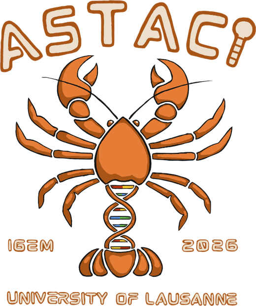
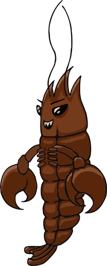
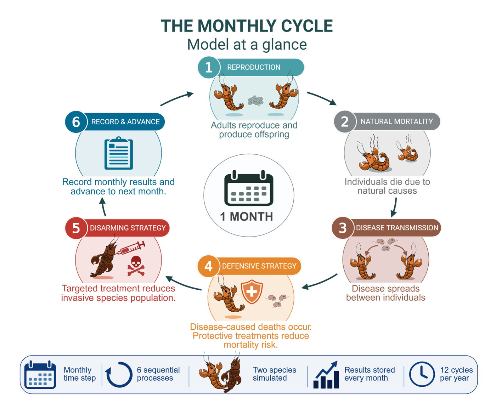
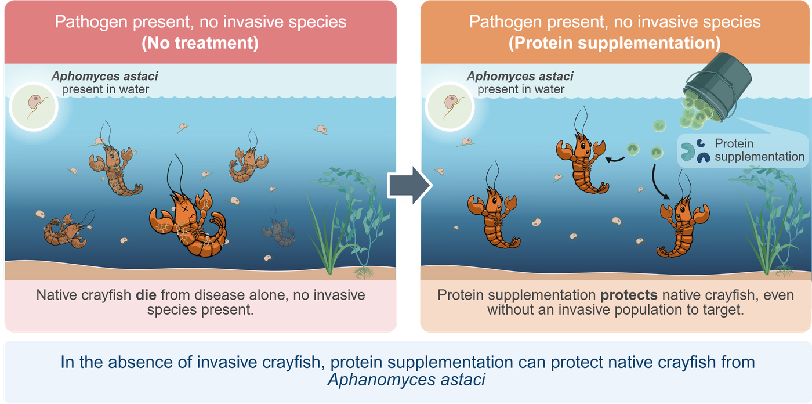

<p align="center">
  
</p>

<h1 align="center">Stochastic Treatment Efficacy Model</h1>

<p align="center">
  Which treatment saves native crayfish from crayfish plague?<br>
  <sub>Dry Lab model · Project ASTACI · iGEM 2026 · University of Lausanne</sub>
</p>

<p align="center">
  <a href="https://github.com/catalantatayandres-glitch/stochastic-treatment-efficacy-model/actions/workflows/tests.yml"></a>
  
  
</p>

---

## What is iGEM?

**iGEM** (International Genetically Engineered Machine) is the world's largest synthetic
biology competition. Every year, student teams from around the world spend several months
designing and testing biological solutions to real problems. Teams combine lab work,
computer modelling (the "Dry Lab") and work with the people affected by the problem.

## Our project: ASTACI

Native European crayfish are disappearing. The main cause is **crayfish plague**, a disease
brought to Europe by the invasive **signal crayfish**. Signal crayfish carry the disease without
getting sick, but infected native crayfish die at rates close to **100 %**. In Switzerland, all
native crayfish species are now highly threatened.

The **UNILausanne** team (University of Lausanne) designed **ASTACI**, a three-part response:

|  |  |  |
|:---:|:---:|:---:|
| **Detect** the disease | **Disarm** the carrier | **Defend** the native |
| A field test that finds the pathogen in water | RNAi makes invasive carriers vulnerable to their own disease | A protein supplement helps natives survive infection |

This repository contains the **computer model** we used to decide how to use *Disarm* and
*Defend*.

---

# The model

## The questions

1. Do the treatments actually help native crayfish survive?
2. What is the best way to use them: one, the other, or a mix of both?

## How it works

The model follows a river with both species, **month by month for 10 years**. It counts
individual crayfish and sorts them into four groups:

| | Healthy | Carrying or infected |
|---|---|---|
| **Invasive crayfish** | $I_S$ | $I_C$ (carriers, not harmed by the disease) |
| **Native crayfish** | $N_S$ | $N_I$ (infected, usually die) |

Every month, the same six events happen in the same order:

<p align="center">
  
</p>
<p align="center"><sub><b>Figure 1.</b> The monthly cycle of the model, repeated 120 times.</sub></p>

Each event involves chance, so two runs never end exactly the same. We run each scenario
30–50 times and show the **median** result, with a shaded band for the range of likely
outcomes.

### The equations

**① Reproduction.** Each species grows until it fills its habitat, and the other species takes up space too:

```math
\lambda_I = r_I I \left(1 - \frac{I + \alpha_{IN} N}{K_I}\right), \qquad \lambda_N = r_N N \left(1 - \frac{N + \alpha_{NI} I}{K_N}\right)
```

```math
\text{newborns} \sim \text{Poisson}(\lambda)
```

**② Natural death.** Each crayfish dies with a small monthly probability $m$:

```math
\text{deaths} \sim \text{Binomial}(n,\ m)
```

**③ Disease transmission.** The more carriers among the invasives, the higher the infection risk for a native:

```math
p_{\text{infection}} = 1 - e^{-\beta I_C / I}
```

> **Treatment doses** (used in steps ④ and ⑤)
>
> Each month a share $c$ of crayfish receives a dose (coverage). A fraction $f$ of the doses is RNAi and $1-f$ is protein. With treatment efficacies $e_N$ and $e_I$:
>
> ```math
> p_{\text{protect}} = c \cdot (1-f) \cdot e_N
> ```
>
> ```math
> p_{\text{kill}} = c \cdot f \cdot \big(1 - c \cdot (1-f)\big) \cdot e_I
> ```
>
> The factor $1 - c \cdot (1-f)$ appears because a carrier that also receives protein in the same month is rescued by it.

**④ Defend.** Infected natives that receive protein are protected for the month. The others die with probability $\mu_A$:

```math
\text{protected} \sim \text{Binomial}\big(N_I,\ p_{\text{protect}}\big), \qquad \text{plague deaths} \sim \text{Binomial}\big(N_I - \text{protected},\ \mu_A\big)
```

**⑤ Disarm.** RNAi kills only carriers:

```math
\text{RNAi deaths} \sim \text{Binomial}\big(I_C,\ p_{\text{kill}}\big)
```

## Parameters

<details>
<summary><b>Click to see the parameters</b> (values and sources)</summary>
<br>

All rates are per month.

| Symbol | Meaning | Value | Source |
|---|---|:---:|---|
| $I_0,\ N_0$ | Starting population | 20 % of $K$ | Modelling choice |
| $p_{C0}$ | Share of invasives carrying the disease at the start | 0.2 | Filipová et al. 2013 (20 % of over 500 signal crayfish tested positive) |
| $p_{\text{rc}}$ | Share of invasive newborns that are carriers | 0.2 | Same as above |
| $r_I,\ r_N$ | Growth rate | 0.45, 0.12 | Fecundity data; invasives grow about 4× faster (Jin et al. 2019; Wendler et al. 2015; Grandjean et al. 2000) |
| $K_I,\ K_N$ | Habitat capacity | 6,400, 5,500 | Field densities (Bubb et al. 2011; Guan 2000; Wendler et al. 2015; Pearson 2011) |
| $\alpha_{IN},\ \alpha_{NI}$ | Competition between species | 0.3, 0.5 | Calibrated in Validation (direction from Vaeßen & Hollert 2015) |
| $m_I,\ m_N$ | Natural death rate | 0.08, 0.01 | Jin et al. 2019; native lifespan of 9–11 years (Wendler et al. 2015) |
| $\beta$ | How easily the disease spreads | 0.9 | Calibrated in Validation (no published value, Bozzuto et al. 2024) |
| $\mu_A$ | Death rate of infected natives | 0.8 | Near-total death within 60–120 days (Martínez-Ríos et al. 2022; Martín-Torrijos et al. 2017) |
| $c$ | Coverage: share of crayfish reached each month | 0.5 | Scenario choice |
| $f$ | Share of the treatment that is RNAi | 0 to 1 | What we are testing |
| $e_I,\ e_N$ | Treatment efficacy | 1.0 | Best-case target |

</details>

## Results

We tested six ways of splitting the same treatment effort, from all protein to all RNAi.

<p align="center">
  
</p>
<p align="center"><sub><b>Figure 2.</b> Native crayfish over 10 years for six ways of splitting the treatment, from all protein (blue) to all RNAi (red). Lines are medians; shaded bands show the range of likely outcomes.</sub></p>

| Strategy | Native crayfish after 10 years (start: about 1,100) |
|---|---|
| No treatment | ❌ Gone after about 4 years |
| All protein | ❌ Gone after about 5 years |
| 25 % RNAi | ❌ Gone after about 8 years |
| 50 % RNAi | ⚠️ About 115, still falling |
| 75 % RNAi | ⚠️ About 620, stable |
| **All RNAi** | ✅ **About 1,240, growing** |

**The more RNAi, the better.** We checked this across other habitats, competition levels,
coverage, efficacy and migration, and the pattern always held (see
[Other explorations](#other-explorations)).

### So is the protein useless?

No. A Swiss conservation foundation, La Maison de la Rivière, told us about native crayfish
that were released into a lake with **no invasive crayfish** and still died, because the
disease was already in the water. RNAi cannot help there, because there are no carriers to
target. **The protein is the right tool for these reintroductions.**

<p align="center">
  
</p>
<p align="center"><sub><b>Figure 3.</b> In a lake with the disease but no invaders, the protein protects native crayfish. Created with BioRender.com.</sub></p>

## Why RNAi wins

Native crayfish face **two problems**: invasive crayfish compete with them for space and food,
and they spread the disease. The protein only solves the disease. RNAi solves **both**,
because removing carriers stops the disease and also shrinks the invasive population.

## Validation

How do we know the model is realistic? We checked it against a real event.

1. **The test case.** Scientists followed a river where both species lived in 2003 (Bubb, Thom & Lucas 2006). By 2005, **every native crayfish was gone**, and the invaders had increased.
2. **The unknowns.** Two important parameters, competition and disease spread (β), have no published values.
3. **The fit.** We ran the model with no treatment for two years, trying different values for these two parameters (Figure 4).
4. **The choice.** Moderate competition with β = 0.9 reproduces the real collapse at **95 %**. A high-competition setting fitted slightly better (97 %), but it does not match the "neutral" habitat used in the rest of the study.
5. **The result.** With these values, natives fall by 95 % in two years while invaders grow by more than 300 % (Figure 5). We used these values for all results.

<table>
  <tr>
    <td width="50%"></td>
    <td width="50%"></td>
  </tr>
  <tr>
    <td valign="top"><sub><b>Figure 4.</b> How closely each combination matches the real collapse (100 % = perfect match). The outlined cell was selected.</sub></td>
    <td valign="top"><sub><b>Figure 5.</b> Native and invasive crayfish over two years with the selected values and no treatment.</sub></td>
  </tr>
</table>

## Other explorations

<details>
<summary><b>Which parameters matter most?</b> Disease spread, native habitat size and the share of carrier newborns.</summary>
<br>
<p align="center"></p>
We changed one parameter at a time and measured how much the final native population moved.
</details>

<details>
<summary><b>Does RNAi win in every habitat?</b> It never loses in the 27 scenarios tested.</summary>
<br>
<p align="center"></p>
Green means RNAi beats protein. RNAi wins outright in 22 scenarios. In the other 5, both strategies fail equally.
</details>

<details>
<summary><b>What if the treatment works less well?</b> RNAi is far more forgiving.</summary>
<br>
<p align="center"></p>
The protein only saves natives when almost every crayfish is reached and the dose always works (above about 95 %). RNAi still works well at much lower levels.
</details>

<details>
<summary><b>What if crayfish move in and out?</b> RNAi still protects the natives.</summary>
<br>
<p align="center"></p>
With 5 % of crayfish moving each month, natives arriving from healthy surroundings even raise the population further.
</details>

## Assumptions

<details>
<summary><b>Click to see the assumptions</b></summary>
<br>

1. The river is one well-mixed site, with no geography.
2. Events happen monthly, always in the same order, with no breeding season.
3. Only invasive carriers spread the disease.
4. Carriers are not harmed by the disease.
5. 20 % of invasive newborns are carriers.
6. Infected natives do not recover on their own.
7. Protection lasts one month and must be renewed.
8. RNAi affects only carriers; a carrier that also takes the protein is rescued.
9. Treatment is given every month.
10. The reference habitat is "neutral": it favors neither species.
11. When migration is on, both species move at the same rate (in reality signal crayfish move about twice as far).
</details>

## Limitations

<details>
<summary><b>Click to see the limitations</b></summary>
<br>

1. Competition and disease spread were calibrated on one river only.
2. The validation compares overall trends, not exact numbers.
3. Parameters were tested one at a time, so combined effects are not captured.
4. Some rates come from a related species, the red swamp crayfish.
5. The disease cannot exist without invaders in the model, so lakes with only the disease cannot be simulated.
6. Coverage and efficacy are targets, not measured field values.
</details>

## References

<details>
<summary><b>Click to see the references</b></summary>
<br>

1. Bozzuto, C. et al. (2024). *Journal of Freshwater Ecology.*
2. Bubb, D.H., Thom, T.J. & Lucas, M.C. (2004). Movement and dispersal of the invasive signal crayfish *Pacifastacus leniusculus* in upland rivers. *Freshwater Biology*, 49, 357–368.
3. Bubb, D.H., Thom, T.J. & Lucas, M.C. (2006). Movement, dispersal and refuge use of co-occurring introduced and native crayfish. *Freshwater Biology*, 51, 1359–1368.
4. Bubb, D.H. et al. (2011).
5. Filipová, L. et al. (2013). *PLOS ONE.*
6. Grandjean, F. et al. (2000).
7. Guan, R.-Z. (2000).
8. Jin, S. et al. (2019). *PeerJ.*
9. Martín-Torrijos, L. et al. (2017).
10. Martínez-Ríos, M. et al. (2022).
11. Pearson, M. (2011).
12. Pritchard, E. (2020). *The Conversation.*
13. Vaeßen, S. & Hollert, H. (2015).
14. Wendler, F. et al. (2015). *Knowledge and Management of Aquatic Ecosystems.*
15. La Maison de la Rivière, personal communication.

Full citations are on the [team wiki](https://2026.igem.wiki/unilausanne/model/).
</details>

---

# Run it yourself

```bash
git clone https://github.com/catalantatayandres-glitch/stochastic-treatment-efficacy-model.git
cd stochastic-treatment-efficacy-model
pip install -e .

python run_all.py      # recreate every figure (about 30 seconds)
```

<details>
<summary><b>More: use the model in Python, run the tests, folder layout</b></summary>
<br>

**Run one simulation:**

```python
from stochastic_treatment_efficacy_model import DEFAULT_PARAMS, simulate_combined_treatment

params = {**DEFAULT_PARAMS, "K_I": 6400, "K_N": 5500, "beta": 0.9,
          "overall_encounter_rate": 0.5,   # coverage c = 50 %
          "mix_fraction_kill": 1.0}        # f = 1: all RNAi
df = simulate_combined_treatment(params, seed=0)   # one row per month
print(df[["year", "I", "N"]].tail())
```

**Run the tests:** `pip install -e ".[dev]"`, then `pytest`.

**Folder layout:**

```
src/stochastic_treatment_efficacy_model/engine.py   the model
analyses/      one script per figure (main_results, validation_bubb2006, ...)
figures/       the generated figures
docs/images/   logo and illustrations
tests/         automatic checks
run_all.py     recreates every figure
```

</details>

---

<p align="center">
  <sub>Developed by the <b>iGEM 2026 UNILausanne</b> team, University of Lausanne, Switzerland ·
  <a href="https://2026.igem.wiki/unilausanne/model/">Wiki model page</a><br>
  Code: <a href="LICENSE">MIT License</a> · Logo, illustrations and wiki content: © UNILausanne iGEM 2026, CC BY 4.0 · Figure 3 created with BioRender.com</sub>
</p>
